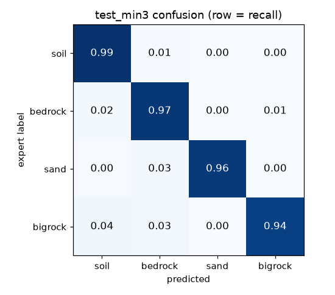

# Marswalk Planner: Gale Crater, with an AI ground-check layer

**NASA Space Apps 2026, Challenge #10: Interplanetary Survival Guide: Martian Map.**
The challenge asks for *a layered, integrated view of a location or route on the Martian surface
that pulls together data from multiple NASA science missions and could help a human explorer plan
and carry out a successful Marswalk while doing new and exciting science along the way.*

Live demo: `<add Hugging Face Space link>` · Video: `<add link>`

## The problem

A walk on Mars is planned on Earth, from orbit, long before anyone steps out. Two things end
excursions: **ground you cannot cross** (steep slopes, soft sand: sand ended the Spirit rover's
mission in 2009) and **ground not worth crossing** (a walk that misses the science). The data to
judge both exists, but it is scattered across missions, instruments and archives.

## What we built

**1. Marswalk Map (Gale Crater, Curiosity's field site)**: one Leaflet map with layers from
five NASA data sources:

| Layer | Mission / instrument | Source |
|---|---|---|
| CTX global mosaic (~6 m/px) | MRO Context Camera | NASA Mars Trek WMTS (Caltech Murray Lab beta01 mosaic) |
| MOLA colour hillshade (463 m/px) | MGS Mars Orbiter Laser Altimeter | NASA Mars Trek WMTS |
| Elevation and **slope hazards** (>15°, >25°) | MGS MOLA MEGDR, 128 px/deg | PDS Geosciences Node (range-read, Gale only) |
| **Clay / sulfate** band-parameter strength | MRO CRISM MTRDR FRT0000A091 (D2300, SINDEX2, BD1900_2) | PDS Geosciences Node |
| Hydrous mineral detections | MRO CRISM + Mars Express OMEGA | NASA Mars Trek |
| Curiosity traverse, 1,389 waypoints, science sites | MSL Curiosity | NASA MMGIS (mars.nasa.gov/maps) |

**Route tool:** click waypoints and get distance, elevation profile, climb and descent, **slope
risk**, how much of the walk follows ground Curiosity already drove (proven trafficable),
**science stops** within 1.5 km, and an **estimated walking time** (3 km/h on flat ground,
Tobler's slope penalty, plus 15 min per science stop).

**2. AI Ground Check**: for the last-metre question orbital data cannot answer ("is *this* patch
sand?"). Upload a rover Navcam image and the model colours every part as **soil / bedrock / sand /
big rock**. Sand and big rock become hazards on a probability cost map, A* draws the safest route
through the near field, and a briefing gives a GO / CAUTION / HOLD verdict.

## AI method (CPU only)

1. Data: NASA/JPL AI4Mars (Curiosity Navcam, CC0), streamed from Hugging Face
   (`hassanjbara/AI4MARS`). 1,500 labelled train images (spread over all 13 shards; images with <5%
   labelled pixels skipped) and all 322 images of the official expert test set.
   Rover body and ground beyond 30 m are masked out.
2. Features: frozen **DINOv2-small** (Meta). Our own preprocessing (no `AutoImageProcessor`):
   resize to 448×448, grey → 3 channels, ImageNet normalisation → a 32×32 grid of 384-d patch features.
3. Cell labels: majority class of each 32×32-pixel cell with ≥60% labelled pixels, at most 250
   cells per image (class-balanced).
4. Classifiers: Logistic Regression and LightGBM, both class-balanced. Validation split **by image**
   (85/15), and the model is picked by validation mIoU: **LightGBM** (val mIoU 0.746 vs 0.697).
5. Test: class probabilities are bilinearly upsampled to 1024×1024 and scored pixel by pixel against
   the expert masks, ignoring unlabelled pixels.

**Leakage check:** the dataset has no file names, so every image is identified by an MD5 hash of
its pixels. No test image appears in train or validation (asserted in code; ids in
`results/image_ids.json`).

## Results (official AI4Mars test set, 322 images)

| Test split | Pixel acc | mIoU | Sand recall | Sand IoU | Big-rock recall | Big-rock precision | Baseline acc / mIoU |
|---|---|---|---|---|---|---|---|
| test_min1 | 91.8% | 0.665 | 87.6% | 0.848 | 49.6% | 0.13 | 30.9% / 0.077 |
| test_min2 | 95.5% | 0.711 | 93.7% | 0.920 | 80.8% | 0.11 | 27.4% / 0.068 |
| **test_min3** | **97.8%** | **0.777** | **96.3%** | **0.956** | 93.7% | 0.26 | 22.4% / 0.056 |

*Baseline* = always predict the most common **training** class (bedrock); no test information is
used. `test_min3` has the strictest labeller agreement (cleanest labels). Even a constant guess of
the most common *test* class (soil) would score at most 51%.



Reference points (protocol not identical, so not a like-for-like comparison): JPL reports
DeepLabv3 at ≈96% pixel accuracy on AI4Mars and SPOCv2 at 91.4%. Those models are fine-tuned
end-to-end on GPUs; ours is a frozen foundation model plus a small classifier on a laptop CPU
(~0.5 s per image).

Good and failure examples are in `results/examples/`. The worst cases are deep shadows on dune
fields, which get read as bedrock or big rock.

## Limits (read before trusting a route)

- **Big rocks are rare** (0.9% of training pixels, 0.1–0.2% of test pixels). Recall is high but
  precision is low (0.11–0.26): the model over-calls big rocks, so the planner is conservative, not
  blind.
- **Slope comes from 463 m MOLA cells.** It finds crater walls and mound flanks but averages out
  boulders, scarps and small craters. A real Marswalk needs HiRISE-scale (1 m) slopes.
- **CRISM layers show band-parameter strength from one observation** (FRT0000A091, lower Mount
  Sharp), not confirmed mineral maps. The clay signal in that cube is weak. Orbital hydrous
  detections are given only to 0.1°.
- **AI sand risk is not on the map.** The AI works on rover images, and the AI4Mars images used here
  carry no location, so they appear as a *ground-truth gallery from Curiosity's route* rather than
  as geolocated markers. The map instead reports how much of a route follows Curiosity's proven path.
- **The image route is a camera-view preview** (lower 60% of the frame, where labels exist), not
  distances in metres.
- **Walk time** is a planning estimate (Tobler's function rescaled to 3 km/h), not a validated EVA
  model.

## How to run

```bash
python -m venv .venv && . .venv/bin/activate          # Windows: .venv\Scripts\activate
pip install -r requirements.txt
python app.py                                         # http://127.0.0.1:7860
```

The repo ships everything the app needs (`models/`, `geo/`, `samples/`, `results/`). To rebuild
from scratch (about 45 min on a laptop CPU; heavy files go to `SANDTRAP_DATA`, default `data/`):

```bash
python src/data.py          # stream AI4Mars, clean masks, previews, class counts
python src/features.py      # DINOv2 features (cached, resumable)
python src/train.py         # LogReg vs LightGBM, chosen by val mIoU
python src/evaluate.py      # test metrics, baseline, confusion matrix, examples
python src/make_samples.py  # demo samples + analysed gallery
python src/geo.py           # Gale map layers from Mars Trek, PDS and MMGIS
pytest -q                   # planner, data and feature tests
```

## Repo layout

```
app.py              Gradio app (Marswalk Map, AI Ground Check, Data & limits)
config.py           constants (IMG=448, GRID=32, classes, seeds, planner weights)
src/data.py         streaming loader, mask cleaning, content-hash ids
src/features.py     DINOv2 feature extractor (batch, cache, resume)
src/train.py        LogReg + LightGBM, by-image validation
src/evaluate.py     pixel metrics, baseline, confusion matrix, examples
src/planner.py      image cost map + 8-direction A*
src/briefing.py     drive briefing text
src/geo.py          builds geo/ layers from NASA sources
src/marswalk.py     map route analysis (slope, stops, proven ground, walk time)
tests/              pytest
```

## Credits

Data: NASA/JPL-Caltech **AI4Mars**; **NASA Mars Trek** (CTX mosaic: NASA/JPL/MSSS, Caltech Murray
Lab; MOLA: NASA/JPL/GSFC; CRISM/OMEGA hydrous detections); **PDS Geosciences Node** (MOLA MEGDR,
CRISM MTRDR); **NASA MMGIS** (Curiosity traverse, waypoints, science sites).
Model: DINOv2 (Meta AI). Libraries: PyTorch, Transformers, scikit-learn, LightGBM, Gradio, Leaflet.
